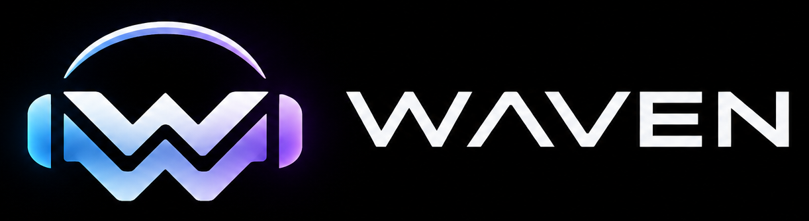

<p align="center">
  
</p>

<p align="center">
  <a href="https://github.com/12errh/waven/actions/workflows/ci.yml"></a>
  <a href="https://github.com/12errh/waven/actions/workflows/release.yml"></a>
  <a href="LICENSE"></a>
</p>

# WAVEN

A local-first desktop music player for your own library. WAVEN is a Next.js interface embedded
in a Go/Wails shell, so it ships as one native binary with full filesystem access. Your music,
tags, artwork, playlists, and preferences stay on your machine — there are no accounts, cloud
sync, or streaming services.

## Features

- **Local library** — add folders, scan tags and embedded artwork, browse tracks, albums,
  artists, genres, likes, and playlists. Scans are incremental and cancellable.
- **Playback** — queue, shuffle, repeat (off/all/one), volume, seek, and a resumable session.
  Audio streams over a loopback server with Range support, so large files seek immediately.
- **Mini player** — a real ~380×128 native window that floats above other apps. Playback keeps
  running in the hidden full window, so expanding restores the exact position and queue.
- **Custom layout** — drag the dock, top tabs, and now-playing card to new positions; resize the
  split; reset to defaults. Arrangement is persisted per installation.
- **Appearance** — Glass (cover-tinted), Pure glass, and Solid modes switch instantly.
- **Tray integration** — transport controls, show/hide, mini/full switch, close-to-tray, and
  optional start-hidden / launch-at-login.
- **Native drops and shortcuts** — drop folders onto the window to import them, and control
  playback from the keyboard.

## Install

Download an artifact from the repository's Releases page (or a successful CI run):

| Platform | Artifact | Notes |
|---|---|---|
| Linux | `.deb`, AppImage | WebKitGTK and GStreamer plugins are declared in the `.deb`; AppImage is best effort. |
| Windows | NSIS installer | Per-user install, no admin prompt; WebView2 bootstrapper included. |
| macOS | `.dmg` (arm64 and amd64) | Drag WAVEN to Applications. Unsigned builds need right-click → Open. |

Builds are unsigned unless signing is configured for the release. See
[`RELEASE_NOTES.md`](RELEASE_NOTES.md) for the current release and known limitations.

## Build from source

Requirements:

- Go 1.26+
- Node.js 20+ and npm
- `wails3` v3.1.0 on `PATH` (`go install github.com/wailsapp/wails/v3/cmd/wails3@v3.1.0`)
- Linux: GTK 3/4, WebKitGTK, and GStreamer development packages

```sh
npm --prefix frontend ci
wails3 task build      # regenerate bindings, export the frontend, build bin/waven
./bin/waven
```

`VERSION` injects the version shown in **Settings → About**:

```sh
wails3 task build VERSION=1.2.3
```

For a live-reloading dev loop:

```sh
wails3 task dev        # Next.js HMR on port 9245 + Go hot restart
```

The dev port is literal in `build/config.yml`; keep it in sync with `DEV_PORT` in
`Taskfile.yml`. Go changes rebuild `bin/waven-dev`; frontend edits hot-reload.

## Using WAVEN

**Library → Add folder** registers a root and starts a scan. Dropping folders onto the window
does the same. Supported formats are MP3, AAC/M4A, FLAC, WAV, AIFF, OGG, and Opus; MP4, M4V,
WebM, and MKV are indexed for their audio track. ALAC is not supported.

Keyboard shortcuts (ignored while typing in a field):

| Key | Action |
|---|---|
| `Space` | Play / pause |
| `N` / `P` | Next / previous track |
| `←` / `→` | Seek 5 seconds |
| `L` | Like the current track |
| `M` | Toggle the mini player |
| `Esc` | Expand mini player / leave a dialog |
| `Ctrl`/`Cmd` + `F` | Focus global search |

The header is a drag strip; controls opt out with `.wails-no-drag`. The layout toolbar (top
right) enables the drag handles for the dock, tabs, and hero card, plus split resizing and reset.

Close hides to the system tray when a StatusNotifier host is available. Without one (for example
a stock GNOME session), close quits so the app can never be stranded invisibly.

### Where data lives

- Database: `<config>/waven/waven.db`
- Artwork cache: `<cache>/waven/artwork`
- Overrides: `WAVEN_DATA_DIR` and `WAVEN_CACHE_DIR` (handy for a throwaway library)

No network connection is required after installation.

## Packaging and CI

Package tasks build on the production build and are intended to run on native CI runners:

```sh
wails3 task package:linux:deb VERSION=0.1.0 ARCH=amd64
wails3 task package:linux:appimage VERSION=0.1.0
wails3 task package:windows VERSION=0.1.0 ARCH=amd64   # needs makensis
wails3 task package:darwin VERSION=0.1.0 ARCH=arm64    # macOS only; .app + .dmg
```

Artifacts land in `bin/`. Installer metadata lives in `build/linux/`, `build/windows/`, and
`build/darwin/`. The GitHub Actions matrix in
[`.github/workflows/release.yml`](.github/workflows/release.yml) runs tests on Linux and builds
Linux, Windows, and both macOS architectures on `v*` tags, uploading each artifact to the
workflow run. Attach those artifacts to the matching GitHub release to publish them.

Before publishing, run the manual pass in
[`docs/smoke-checklist.md`](docs/smoke-checklist.md).

## Project layout

```
frontend/            Next.js app (static export embedded by Go)
  public/brand/      WAVEN logo and wordmark used by the UI and README
main.go              Wails application entry point
internal/desktop/    Window, tray, settings, and smoke-test behavior
internal/library/    Scanner, metadata, and library services
internal/media/      Loopback media server and artwork cache
internal/store/      SQLite schema and queries
assets_prod.go       Embedded frontend for production builds
assets_dev.go        Disk-served frontend for development builds
build/               Wails config, icons, and installer metadata
docs/                Desktop plan, architecture, and smoke checklist
```

## Diagnostics

- `WAVEN_DEBUG=1` logs window lifecycle events.
- `WAVEN_SMOKE=1` runs the automated desktop-shell check (window controls, mini/full switching,
  tray behavior). Add `WAVEN_SMOKE_LIBRARY=1` to also verify transport commands from the compact
  window against your library.

## More documentation

- [`docs/desktop-plan.md`](docs/desktop-plan.md) — architecture and phase history
- [`docs/smoke-checklist.md`](docs/smoke-checklist.md) — release verification checklist
- [`RELEASE_NOTES.md`](RELEASE_NOTES.md) — current release notes
- [`CHANGELOG.md`](CHANGELOG.md) — version history
- [`CONTRIBUTING.md`](CONTRIBUTING.md) — development loop and checks
- [`SECURITY.md`](SECURITY.md) — vulnerability reporting

## License

WAVEN is released under the [MIT License](LICENSE).
